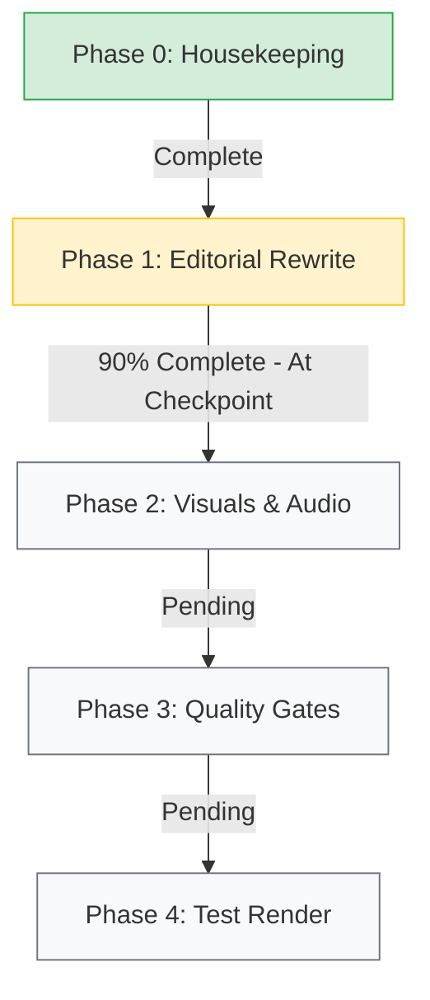

# Project Handoff: WeAware News Video Pipeline Refactor

> **Primary Objective:** Convert the WeAware automated video pipeline from its legacy satirical ("late night / Daily Show") register into a straight, neutral, broadcast-style news program, and fix visual/audio quality issues identified in run `e2f7d8f1-2447-45c3-98e2-12da86569a46`.

---

## 1. Critical Rules & Operational Constraints

> [!CAUTION]
> **1. SECRETS RULE (ZERO TOLERANCE):**
> NEVER print, echo, or inline secrets or API keys (`video-api-key`, database connection strings, GCP credentials, service tokens) in any terminal command, log output, or status report.
> Read secrets into variables inside subshells or fetch them programmatically via Google Cloud Secret Manager. Never write them to stdout/stderr.

> [!IMPORTANT]
> **2. SPEND CONTROL RULE:**
> DO NOT invoke Veo video generation or Imagen backdrop generation without **explicit human approval** at designated checkpoints. Always report estimated costs prior to requesting spend approval.
>
> **3. PUBLISHING & SCHEDULING RULE:**
> DO NOT enable Cloud Scheduler. DO NOT auto-publish or approve review links on behalf of the user.
>
> **4. PHASED EXECUTION & CHECKPOINTS:**
> Work strictly phase by phase. **STOP at each checkpoint** and present findings/outputs to the user before proceeding to subsequent phases.

---

## 2. Project Architecture & Workspace Context

### 2.1 Workspace & Key Locations
- **Repository Root:** `/Users/shreeyansvichare/Code/WeAwareNews`
- **Video Module Root:** `/Users/shreeyansvichare/Code/WeAwareNews/video/`
- **Python Environment:** Python 3.12 (`/Users/shreeyansvichare/miniforge3/bin/python3.12` or repo venv)
- **Reference Run Scratch Data:** `/Users/shreeyansvichare/Code/WeAwareNews/video/scratch/run_e2f7d8f1-2447-45c3-98e2-12da86569a46/`
  - Contains `final.mp4`, `clip_1.mp4` through `clip_4.mp4`, `captions.srt`, and `metadata.json` from the baseline run.
- **Assets Directory:** `/Users/shreeyansvichare/Code/WeAwareNews/video/assets/`
  - `anchors/`: `marcus_medium.png`, `marcus_wide.png`, `maya_medium.png`, `maya_wide.png`
  - `sets/`: `studio_main.png`

### 2.2 Tech Stack & Cloud Services
- **Video API:** FastAPI (`video/api/main.py`), running on Google Cloud Run (`video-api`).
- **Video Runner:** Batch pipeline job (`video/pipeline/runner.py`), running on Google Cloud Run Jobs (`video-runner`).
- **LLM Engine:** Google GenAI SDK (`google.genai`), targeting Vertex AI models (`gemini-2.5-flash`, `gemini-3.8-flash`, `gemini-3.5-flash`, `gemini-2.5-pro`, `gemini-3.1-pro-preview`).
- **Video Generation:** Google Veo via Vertex AI (`video/pipeline/veo_client.py`).
- **Database:** PostgreSQL (`video_runs`, `stories`, `items`).
- **Infrastructure:** OpenTofu (`video/infra/`).
- **Video Assembly:** FFmpeg & libass for subtitle burning and audio mixing.

---

## 3. Work Breakdown & Current Status



### Phase 0: Housekeeping (Status: COMPLETE ✅)
1. **Run Status Cleanup:** Run `e2f7d8f1-2447-45c3-98e2-12da86569a46` transitioned to `rejected`. Aborted run `4036c3c3-cff4-43c5-a590-49eb89379d30` released. Story claims cleared.
2. **API Key Rotation:** `video-api-key` rotated in Secret Manager via OpenTofu. `video-api` and `video-runner` redeployed and verified via automated 401 (unauthorized) and 204 (empty pool) checks.
3. **Safe Review Approval:** Changed review mechanism so `GET /review/{token}` renders a secure review web page, while approval and rejection require a `POST /review/{token}/commit` action. Single-use token enforcement and tests verified.

### Phase 1: Editorial Rewrite (Status: 90% COMPLETE - ACTION REQUIRED)
1. **Scripter Prompt ([`scripter.py`](file:///Users/shreeyansvichare/Code/WeAwareNews/video/pipeline/scripter.py)):** Rewritten to enforce neutral broadcast journalism.
   - Eliminated humor, satire, irony, punchlines, rhetoric, and "late night" tropes.
   - Standard 4-clip structure:
     1. Lead: Who/what/where/when.
     2. Details: Key facts and figures.
     3. Context: Differing perspectives/reactions, strictly attributed ("according to...", "reported by..."). Neutral verbs only ("said", no "slammed" or "admitted").
     4. Next steps & calm broadcast sign-off.
   - Word budget preserved (~20 words per 8s clip, max 88 total).
2. **Editor Gate ([`editor.py`](file:///Users/shreeyansvichare/Code/WeAwareNews/video/pipeline/editor.py)):** Updated with an explicit **Neutrality Audit**.
   - Output includes structured `neutrality_violations: List[str]`.
   - Rejects scripts containing loaded language, editorial opinions, unattributed claims, or satire.
3. **Caption Disclosure ([`text_utils.py`](file:///Users/shreeyansvichare/Code/WeAwareNews/video/pipeline/text_utils.py)):** Standardized to `"Presenters and visuals are AI-generated. Report based on {sources}."` with 2,200 character cap and professional hashtags.
4. **Anchors & Backdrop Prompts ([`anchors.yaml`](file:///Users/shreeyansvichare/Code/WeAwareNews/video/config/anchors.yaml), [`veo_client.py`](file:///Users/shreeyansvichare/Code/WeAwareNews/video/pipeline/veo_client.py)):** Updated for professional business attire, upright neutral posture, newsroom eye-contact, and explicit prompt instruction for quiet newsroom room tone with zero audience laughter or music.
5. **Negative Regression Matrix ([`check_models.py`](file:///Users/shreeyansvichare/Code/WeAwareNews/video/pipeline/check_models.py)):**
   - Implemented 6 negative regression cases (joke, loaded language, unattributed claims, opinionated, contradictory, fabricated) + 1 positive clean script case.
   - Verified across candidate Flash models (`gemini-2.5-flash`, `gemini-3.8-flash`, `gemini-3.5-flash`).
6. **IMMEDIATE PENDING TASK FOR PHASE 1:**
   - Execute a dry run (no Veo calls) using the scripter and editor pipeline against the story from baseline run `e2f7d8f1-2447-45c3-98e2-12da86569a46` (data stored in `video/scratch/run_e2f7d8f1-2447-45c3-98e2-12da86569a46/metadata.json`).
   - Present the resulting script (4 clips, word counts, attributions), caption, and editor verdict.
   - **CHECKPOINT:** Stop and request user approval of script style before proceeding to Phase 2.

---

### Phase 2: Visuals and Audio (Status: PENDING)
1. **Captions Subtitles (Zero Cost):**
   - Address large font issue in `video/pipeline/assembler.py` / ASS subtitle generation. Explicitly set `PlayResX=1080` and `PlayResY=1920` in the ASS header.
   - Target styling: font size 44-52px, bold sans-serif, white with 2-3px dark outline and soft shadow, `BorderStyle=1` (no background box), max 2 lines, ~28 chars/line, left/right margins ~90px.
   - Position: Lower half of frame clearing Instagram UI (~380px from bottom, clear of right button column).
   - Re-render using clips in `video/scratch/run_e2f7d8f1-2447-45c3-98e2-12da86569a46/` and produce sample test frames.
2. **Presenters:** Verify business attire, neutral expression, and newsroom eye contact.
3. **Backdrops:**
   - Presenter Maya Lin requires a visually distinct studio set from Marcus Vance.
   - Generate one new studio plate using the bootstrap script.
   - Request user approval and state cost (~pennies) prior to generation.
4. **No Audience / No Laughter:**
   - Ensure Veo prompt explicitly instructs: *"quiet newsroom room tone only, no laughter, no applause, no audience, no music, no sound effects, only the presenter's voice."*
5. **Clip Boundary Cuts:**
   - Inspect existing `final.mp4` boundaries in `video/scratch/run_e2f7d8f1-2447-45c3-98e2-12da86569a46/final.mp4`.
   - Implement cut logic: prompt Veo to conclude dialogue by ~7s and hold neutral pose; trim clip at speech end + 0.3s; apply 100-150ms audio crossfade.
6. **On-Screen Branding:** Neutral "WeAware News" branding; subtle "AI-generated presenters" notice.
7. **CHECKPOINT:** Show re-rendered caption/cut samples and the new studio plate to user.

---

### Phase 3: Quality Gates (Status: PENDING)
1. **Transcript Gate:** Spoken transcript match ratio >= 0.90 per clip. Allow max 1 retry per clip within the $15 budget cap; fail run if threshold not met.
2. **Audio Check:** Gemini Flash audio analysis flagging laughter, applause, music, or crowd noise; 1 retry allowed.
3. **Failure Notifications:** Ensure failed/aborted runs trigger webhook `event="failed"` with informative `error_message`.
4. **Testing & Image Build:** Unit tests for new gates, build container images, run test suite, report tag.
5. **CHECKPOINT:** Report verification results.

---

### Phase 4: Test Render (Status: PENDING - REQUIRES SPEND APPROVAL)
1. Quote cost, then generate **one 8s test clip** per presenter and backdrop (~$0.80 each) upon explicit approval.
2. Run **one full test episode** (~$3.20 + retries) upon explicit approval.
3. Deliver report (actual Veo cost, transcript match, audio check, ffprobe 9:16 ~32s, loudness ~ -14 LUFS, caption frame samples).
4. Provide review link. **Do not approve or publish.**

---

## 4. Key Modified Files & Git State

All modified files are currently unstaged in `/Users/shreeyansvichare/Code/WeAwareNews`:
- [`video/api/main.py`](file:///Users/shreeyansvichare/Code/WeAwareNews/video/api/main.py): Safe GET review page + POST commit endpoint.
- [`video/api/security.py`](file:///Users/shreeyansvichare/Code/WeAwareNews/video/api/security.py): Security utilities & auth checks.
- [`video/config/anchors.yaml`](file:///Users/shreeyansvichare/Code/WeAwareNews/video/config/anchors.yaml): Anchor visual & audio prompt definitions.
- [`video/config/settings.py`](file:///Users/shreeyansvichare/Code/WeAwareNews/video/config/settings.py): Application settings.
- [`video/pipeline/scripter.py`](file:///Users/shreeyansvichare/Code/WeAwareNews/video/pipeline/scripter.py): Neutral news script generation.
- [`video/pipeline/editor.py`](file:///Users/shreeyansvichare/Code/WeAwareNews/video/pipeline/editor.py): Neutrality and factuality audit gate.
- [`video/pipeline/text_utils.py`](file:///Users/shreeyansvichare/Code/WeAwareNews/video/pipeline/text_utils.py): Caption truncation & disclosure formatting.
- [`video/pipeline/check_models.py`](file:///Users/shreeyansvichare/Code/WeAwareNews/video/pipeline/check_models.py): Regression test suite.
- [`video/pipeline/runner.py`](file:///Users/shreeyansvichare/Code/WeAwareNews/video/pipeline/runner.py): Pipeline execution orchestration.
- [`video/pipeline/veo_client.py`](file:///Users/shreeyansvichare/Code/WeAwareNews/video/pipeline/veo_client.py): Veo prompt assembly.
- [`video/tests/test_video_api.py`](file:///Users/shreeyansvichare/Code/WeAwareNews/video/tests/test_video_api.py): API tests for safe review flow.

All unit tests pass:
```bash
pytest video/tests/ -v
# Output: 52 passed, 12 skipped
```

---

## 5. Helpful Commands for the Next Agent

```bash
# Run existing test suite
pytest video/tests/ -v

# Run the editorial regression against candidate models
python video/pipeline/check_models.py

# Check git status and unstaged changes
git status -s

# Verify no rogue background jobs or dev servers are running
ps aux | grep -iE "vite|weaware|check_models" | grep -v "grep"
```
