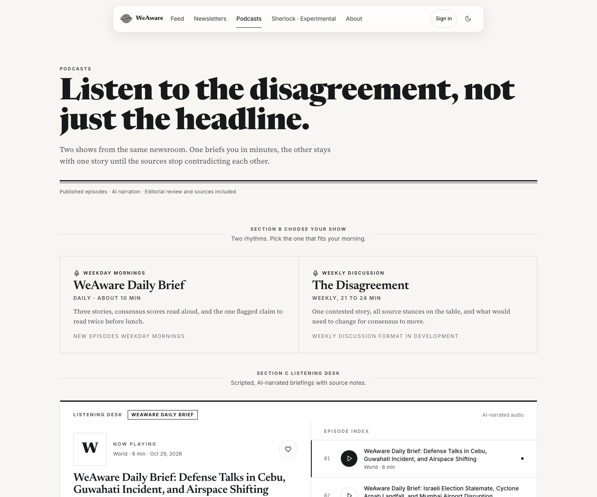
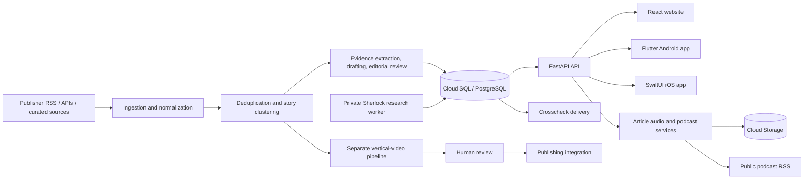

# WeAware

**Independent sources. A clearer picture.** WeAware is a cross-platform news reading product that groups reporting about the same story, links readers to original coverage, and makes areas of agreement, disagreement, and uncertainty easier to inspect. It combines a public website, native Android and iOS apps, news collection and editorial services, newsletters, audio and podcast features, a limited research pilot, and a separately reviewed vertical-video workflow.

> Source agreement and automated summaries are reading aids. They are not a truth score, a complete census of coverage, or a substitute for checking original reporting and editorial judgment.

## Screenshots

These desktop captures show the WeAware website. The feed, article, newsletter, and podcast content comes from the live public API and changes over time.

| Website front page | News feed |
| --- | --- |
|  |  |

| Article reader | Podcasts |
| --- | --- |
|  |  |

### The Crosscheck newsletter page

The website includes a preview of its topic-based email briefing, with linked source coverage and notes on where coverage agrees or differs.


## What the product includes

- **News feed and reader:** Published stories, topic filters, search, source notes, flagged claims where available, and direct links to original reporting. Guests can preview a limited feed; account access expands feed usage.
- **Accounts:** Firebase Authentication supports email/password and Google sign-in. The API verifies Firebase ID tokens before account-specific actions.
- **The Crosscheck:** Readers with a verified email can choose topics and daily or weekly delivery, give explicit consent, manage preferences, send a test edition, and unsubscribe.
- **Listening:** On-demand cached narration for published articles, a shared playback queue, published podcast episodes, and a public podcast RSS feed. Podcast scripts go through editorial review before audio generation and publication.
- **Discover (mobile):** Save or skip story cards, undo a decision, and revisit a local saved library with source evidence. The library is stored on the device and is separate per account.
- **Sherlock Mode:** An experimental, access-controlled research pilot for verified, entitled accounts. It returns evidence-linked reports for editorial review; the pilot has strict admission and spending controls. It is not an unrestricted or guaranteed-accuracy research service.
- **Vertical news video:** A separate pipeline creates attributed short-form episodes. Human review is required before the approved-video endpoint exposes an episode to a publishing integration; approval alone does not publish it.

AI assists with story organization, article drafting, research, narration, podcast production, and video generation. Automated checks can miss factual or framing errors. Review important claims against the linked reporting. Generated audio and video should be disclosed in their playback or publication context.

## Screens and platforms

| Client | Stack | Project guide |
| --- | --- | --- |
| Website | React 18, Vite, Tailwind CSS | [WEAWARE/README.md](WEAWARE/README.md) |
| Android | Flutter | [mobile/android_flutter/README.md](mobile/android_flutter/README.md) |
| iOS | SwiftUI, iOS 17+ | [mobile/ios/README.md](mobile/ios/README.md) |

The mobile apps are native applications, not embedded website views. They share the website's FastAPI backend and Firebase accounts. Their feature details and release limitations are documented in the mobile guides.

## Architecture



The primary news path collects and normalizes feed items, deduplicates and clusters coverage, extracts source text when useful, then drafts articles for editorial review. Only approved articles are published to the public API. PostgreSQL stores story, article, account-preference, and workflow metadata. Cloud Storage holds generated audio. Authentication is provided by Firebase; the API is the authority for protected operations.

Video and Sherlock are distinct workflows with their own human-review, access, and operational controls. They are not required to run the public news website.

## Repository map

| Path | Purpose |
| --- | --- |
| [`WEAWARE/`](WEAWARE/README.md) | Website, frontend configuration, and Firebase web setup |
| [`mobile/`](mobile/README.md) | Mobile application overview and shared API contract |
| [`mobile/android_flutter/`](mobile/android_flutter/README.md) | Flutter Android client |
| [`mobile/ios/`](mobile/ios/README.md) | SwiftUI iOS client |
| [`backend/api/`](backend/api/) | FastAPI routes for articles, topics, accounts, newsletters, audio, podcasts, and editorial actions |
| [`backend/ingestion/`](backend/ingestion/README.md) | Feed polling, normalization, deduplication, clustering, and extraction |
| [`backend/editorial/`](backend/editorial/README.md) | Article evidence, drafting, review, and publication flow |
| [`backend/audio/`](backend/audio/README.md) | Article narration, podcast workflow, RSS, and audio infrastructure |
| [`backend/NEWSLETTERS.md`](backend/NEWSLETTERS.md) | Crosscheck preferences, delivery, and operations |
| [`backend/research/`](backend/research/README.md) | Sherlock research pilot and safety, review, and spend controls |
| [`video/`](video/README.md) | Neutral vertical-video pipeline, review API, and deployment notes |
| [`docs/`](docs/) | Product/engineering planning documents and screenshots |
| [`DECISIONS.md`](DECISIONS.md) | Architecture decisions and known limitations; includes historical notes |
| [`HANDOFF.md`](HANDOFF.md) | Current high-level system map and operational handoff |
| [`cloudbuild.yaml`](cloudbuild.yaml) | News collection, clustering, database sync, and editorial build pipeline |

## Run the website locally

Requirements: Node.js and npm. The checked-in website is a Vite app.

```sh
cd WEAWARE
npm install
cp .env.example .env.local  # optional: configure Firebase sign-in
npm run dev
```

Vite prints the local URL (normally `http://localhost:5173`). Public feed data comes from the configured API. The development server proxies `/api` to `http://localhost:8080` by default; set `VITE_API_BASE_URL` in `.env.local` to point at another API origin. Firebase web configuration is needed for sign-in and account features, but is not a server secret. See [WEAWARE/AUTH_SETUP.md](WEAWARE/AUTH_SETUP.md) before configuring authentication or deployment.

Build and serve the production bundle locally:

```sh
npm run build
npm run preview
```

## Run the mobile apps

Mobile setup has platform-specific prerequisites and account configuration. Start with [mobile/README.md](mobile/README.md), then follow the corresponding client guide:

- **Android:** Flutter 3.41+, Android Studio, and Android SDK; run `flutter pub get` and `flutter run` from `mobile/android_flutter/`.
- **iOS:** Xcode and an iOS 17+ simulator; open `mobile/ios/WeAware.xcodeproj` and run the `WeAware` scheme.

Public news and podcast reading can run without local Firebase account configuration. Private account actions require the appropriate Firebase application setup. Use a reachable API URL when testing from a physical device; a device's `localhost` refers to the device itself. The platform guides explain local configuration files and signing; never commit those files or server credentials.

## Backend and data services

The website and mobile apps use the FastAPI service in `backend/api/`. It serves public articles and topics, audio and podcast endpoints, and Firebase-authenticated user actions. PostgreSQL is the main application database. Google Cloud services support the deployed system, including Cloud Run, Cloud SQL, Cloud Storage, Secret Manager, Cloud Tasks, Vertex AI, and Cloud Scheduler for configured workflows.

The collection and editorial workflow is automated through Cloud Build. `cloudbuild.yaml` collects feeds, reclusters stories, syncs to PostgreSQL, and invokes the article and podcast drafting pipelines. Drafted articles and podcast scripts are subject to editorial approval. Newsletter delivery, article-audio generation, Sherlock research, and vertical-video generation have separate configurations and operational controls.

This repository is not a one-command local deployment of all cloud services. To run backend jobs or deploy services, review the specific service guide, configure credentials and disposable/development resources, and follow its documented migration, review, budget, and scheduling gates. Do not point local experiments at production data or enable paid/scheduled jobs as a smoke test.

## Configuration and secrets

- **Website:** `WEAWARE/.env.example` lists `VITE_FIREBASE_*` values and the optional `VITE_API_BASE_URL`. See [Firebase setup](WEAWARE/AUTH_SETUP.md).
- **Android and iOS:** platform-specific local Firebase config is ignored by Git; examples and setup instructions are in each client guide.
- **Backend:** service credentials, database passwords, provider keys, signing secrets, and delivery tokens belong in Secret Manager or local ignored configuration, never source code or frontend variables.
- **API access:** public reading endpoints do not require a user account; protected routes validate Firebase identity and enforce ownership or editorial permissions server-side.

## Testing and validation

Each component has its own checks and environment requirements. From the repository root, relevant commands include:

```sh
npm --prefix WEAWARE run build
(cd mobile/android_flutter && flutter analyze && flutter test)
xcodebuild -project mobile/ios/WeAware.xcodeproj -scheme WeAware \
  -sdk iphonesimulator -configuration Debug \
  -derivedDataPath /tmp/weaware-ios-build CODE_SIGNING_ALLOWED=YES CODE_SIGN_IDENTITY=- build
```

Backend and video checks are documented in [backend/research/README.md](backend/research/README.md), [backend/audio/README.md](backend/audio/README.md), and [video/README.md](video/README.md). Some tests need extra dependencies, a disposable PostgreSQL database, simulators, credentials, or mocked provider calls. Hosted AI generation, live email delivery, editorial approvals, and production data changes are not routine tests; follow each guide's explicit controls.

## Editorial, privacy, and security principles

- Keep links and attribution to original reporting. Source count and agreement describe coverage; they do not prove a claim.
- Treat AI-generated summaries, research, audio, and video as fallible. Review material claims and media before publication.
- Keep account preferences and research reports private to their owner; use server-side identity and authorization checks.
- Keep human review gates in place for article publication, podcast publication, research delivery, and video approval.
- Never commit credentials, service-account keys, API tokens, personal configuration files, or production database URLs. Use disposable test accounts and databases for validation.

## Further documentation

- [Website setup and source layout](WEAWARE/README.md)
- [Firebase authentication setup](WEAWARE/AUTH_SETUP.md)
- [Mobile clients and API contract](mobile/README.md)
- [News collection](backend/ingestion/README.md)
- [Article publishing](backend/editorial/README.md)
- [Newsletter behavior and operation](backend/NEWSLETTERS.md)
- [Article audio and podcasts](backend/audio/README.md)
- [Sherlock research pilot](backend/research/README.md)
- [Vertical-video workflow](video/README.md)
- [Architecture decisions and limitations](DECISIONS.md)
- [System handoff](HANDOFF.md)
